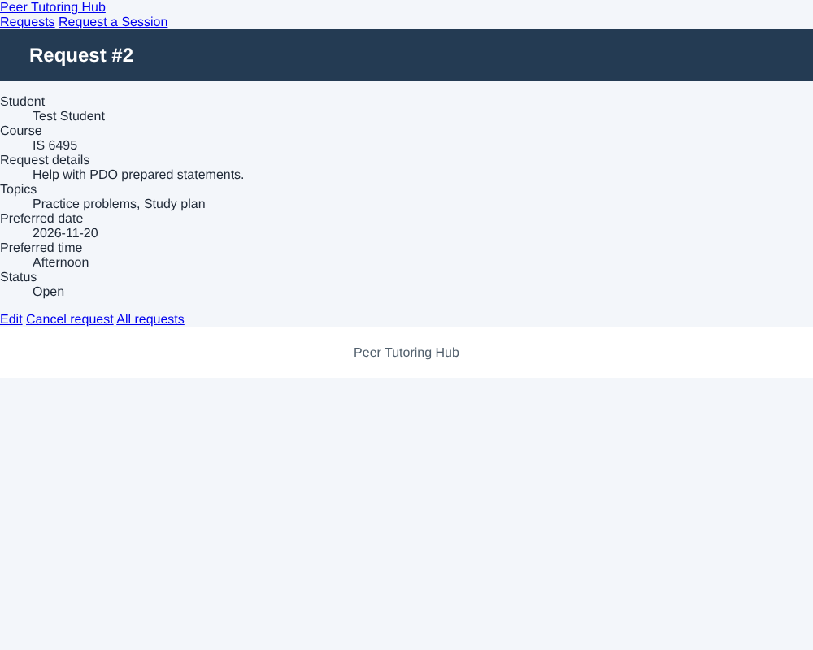

# Lab 6 Notes – PHP, PDO, and SQLite Integration

**Student:** Samuel Nsimba
**Codespaces link:** `https://congenial-yodel-775qp9xrg6wxf76p.github.dev/`

---

## Part 1: Set Up the Database

Command used (from the `lab6` root):

```bash
sqlite3 database/tutoring.db < database/setup-database.sql
```

Confirmation:

```text
$ sqlite3 database/tutoring.db
sqlite> .tables
students           tutoring_requests
sqlite> .quit
```

Both tables, `students` and `tutoring_requests`, were created. The setup script also adds one sample student (Maria Lopez) and one sample request (request 1).

---

## Part 2: Run the Application

Server command (from the project root):

```bash
php -S 0.0.0.0:8000
```

1. **URL opened:** `https://congenial-yodel-775qp9xrg6wxf76p-8000.app.github.dev/`. The root URL redirected (302) to `/php/request-form.php`.
2. **Confirmation:** I submitted a valid request using test data:
   - Name: Test Student
   - Email: test.student@example.edu
   - Course: IS 6495
   - Date: 2026-11-20
   - Reason: "Help with PDO prepared statements."
   - Topics: Practice problems, Study plan
   - Time: Afternoon

   The application saved it and redirected to `request-details.php?request_id=2`. The page displayed all of the values I entered, with status **Open**.
3. **Screenshot of the request detail page:**



---

## Part 3: Test the Application Workflows

| Test | What I Did | Expected Result | Actual Result | Pass or Fail |
|------|------------|-----------------|---------------|--------------|
| Submit a valid request | Filled in the request form with the test data from Part 2 and clicked **Request session**. | A new tutoring request is created with status `Open`. | I was redirected to Request #2, which showed Test Student, IS 6495, my reason, topics, date, Afternoon, and Status **Open**. | Pass |
| View all requests | Clicked **Requests** in the navigation (`php/requests.php`). | The new request appears in the request list. | The list showed request 2 (Test Student, IS 6495, Open) above request 1 (Maria Lopez, IS 6465, Open). | Pass |
| Filter requests | First filtered with Course = IS 6495 and All statuses. Then filtered with All courses and Status = Cancelled, before cancelling anything. | Filtering by course or status shows matching requests. | The IS 6495 filter showed only request 2. The Cancelled filter showed "No matching requests." because nothing had been cancelled yet. | Pass |
| Edit an Open request | Opened request 2, clicked **Edit**, and changed the course to IS 6570, the date to 2026-11-24, the reason to "Help with PDO transactions and JOIN queries.", the topic to Exam review, and the time to Evening. Then clicked **Save changes**. | The revised values are displayed. | I was redirected to Request #2, which showed IS 6570, the new reason, Exam review, 2026-11-24 and Evening, with status still Open. | Pass |
| Cancel an Open request | On request 2, clicked **Cancel request**, then **Yes, cancel request**. | The request status changes to `Cancelled`. | Request #2 showed Status **Cancelled**, and the Edit and Cancel buttons were gone. The record was kept, and the Cancelled filter now lists it. | Pass |
| Try to edit or cancel a cancelled request | Opened `edit-request.php?request_id=2` and `delete-request.php?request_id=2` directly. Also submitted the update and cancel forms for request 2 directly. | The application does not allow the change. | The edit page showed "Only Open requests may be edited." and the cancel page showed "Only Open requests can be cancelled." Both forced submissions returned **409** "Request not found or not Open", and the database row did not change. | Pass |

---

## Part 4: Trace the Request Submission Workflow

1. **Which file displays the tutoring request form?** `php/request-form.php`. It uses `includes/header.php`, `includes/nav.php` and `includes/footer.php`.
2. **Which file receives the submitted form data?** `php/process-request.php`. The form posts to it with `action="process-request.php" method="post"`. It checks that the request is a POST and that `form_name` is `tutoring_request`.
3. **Which file opens the PDO connection to SQLite?** `config/db.php`. Its `openDatabase()` function creates `new PDO('sqlite:…/database/tutoring.db')`, turns on exceptions and associative fetch mode, and runs `PRAGMA foreign_keys = ON`.
4. **Which file coordinates validation and the database transaction?** `services/requestService.php`. `submitRequest()` calls `validateSubmission()`, which uses the helpers in `includes/validation.php`. It then calls `beginTransaction()`, the repository functions, and `commit()`, or `rollBack()` if any step fails.
5. **Which files contain the SQL statements?**
   - `repositories/studentPDO.php`: `SELECT` student by email and `INSERT OR IGNORE` student.
   - `repositories/requestPDO.php`: `INSERT` request, `SELECT … JOIN` to find one request or list requests, and the two `UPDATE` statements for editing and cancelling.
   - `database/setup-database.sql` contains the `CREATE TABLE` and seed `INSERT` statements.
6. **Which table stores student information?** `students`, with columns `student_id`, `student_name` and `student_email`. `student_email` is `UNIQUE`.
7. **Which table stores tutoring requests?** `tutoring_requests`.
8. **How does a tutoring request connect to the student who submitted it?**
   - Each row in `tutoring_requests` has a `student_id` column with `FOREIGN KEY (student_id) REFERENCES students(student_id)`.
   - When a request is submitted, the service inserts the student only if the email is new (`INSERT OR IGNORE`). It then looks up that student's `student_id` by email and saves it in the new request row.

Flow:

```text
Browser form (php/request-form.php)
→ php/process-request.php
→ services/requestService.php        (validateSubmission + transaction)
→ repositories/studentPDO.php and repositories/requestPDO.php
→ SQLite database (database/tutoring.db)
```

**Why SQL belongs in repository files:** Keeping SQL in repository files separates database access from page display. Form pages can focus on HTML and user input, and each query is written once and reused. For example, `findRequest()` is used by the details, edit and cancel pages. If a table or column changes, only the repository needs updating. The SQL can also be tested on its own, which is how `tests/integration-tests.php` calls the service and repository functions against a test database without a browser.

---

## Part 5: Run the Integration Tests

Command:

```bash
php tests/integration-tests.php
```

**Problem found in the starter test file:** The first run reported 3 failures:

```text
PASS UC01 create and Open
PASS Lab 4 checkbox values preserved
FAIL Duplicate email reuses student
FAIL UC02 course and status filter
PASS Invalid reason rejected
FAIL Invalid submission writes nothing
...
FAILURES: 3
```

The test builds its database from `setup-database.sql`, which already contains 1 student (Maria Lopez) and 1 Open IS 6465 request. The three failing checks expected exact counts as if the tables started empty, so:

- it expected 1 student, but there were 2
- it expected 2 filtered requests, but there were 3
- it expected 2 total requests, but there were 3

The application itself was working correctly. I changed only the test file: it now records the starting counts after setup and compares against those counts plus the rows it adds. No application file was changed.

Output after the fix:

```text
PASS UC01 create and Open
PASS Lab 4 checkbox values preserved
PASS Duplicate email reuses student
PASS UC02 course and status filter
PASS Invalid reason rejected
PASS Invalid submission writes nothing
PASS Edit Open request
PASS Updated reason persisted
PASS Cancel Open request
PASS Cancelled row retained
PASS Second cancellation rejected
PASS Unrelated request unchanged
PASS FK enforced
PASS UC02 empty filter result
All integration checks passed
```

---

## Part 6: Use the AI Skills Pack Process

**AI tool used:** Claude (Anthropic)

### Application Builder

**Prompt:**
> Explain how a tutoring request moves from php/request-form.php through PHP, PDO, and SQLite in this project. Identify the responsibility of each file.

**AI response (summary):**
- `php/request-form.php` displays the HTML form. It includes the course select, the date, the reason textarea, the topic checkboxes (`topics[]`), the time radio buttons and a hidden `form_name` field. It posts to `process-request.php`.
- `php/process-request.php` is the controller. It rejects anything that is not a POST, checks `form_name`, opens the database and calls `submitRequest()`. On success it redirects (303) to `request-details.php`. Invalid data gets a 422 response with the error messages, and any other error gets a 500 "Unable to save request".
- `config/db.php` (`openDatabase()`) creates the PDO connection, turns on exception mode and enables foreign keys.
- `services/requestService.php` validates the input with `validateSubmission()`, using the course list and the helpers in `includes/validation.php`. It also encodes the reason and topics as JSON in the single `topic` column and wraps the student and request inserts in one transaction.
- `includes/validation.php` checks the preferred time, the topics and the reason length (10 to 500 characters).
- `repositories/studentPDO.php` and `repositories/requestPDO.php` run the prepared SQL statements.
- `database/tutoring.db` stores the rows in `students` and `tutoring_requests`.
- `php/request-details.php` reads the request back with a JOIN and escapes the output with `htmlspecialchars()`.

**Accurate statement I verified:** "The student and the request are saved in one transaction, so if the request insert fails, the student insert is rolled back too."

I checked `services/requestService.php`, lines 33–40. `submitRequest()` calls `$pdo->beginTransaction()`, then `insertStudentIfAbsent()`, `findStudentByEmail()` and `insertTutoringRequest()`, then `$pdo->commit()`. The `catch` block calls `$pdo->rollBack()` if a transaction is active. The statement is accurate.

### Traceability Auditor

**Prompt:**
> Trace the requirement "a student can submit a tutoring request" through the PHP files, service, repositories, SQLite tables, and integration tests in this project.

**AI response (summary):** The requirement starts at the form page and passes through the controller, the service and its validation, both repositories, and the two tables. It is covered by the integration checks for creating a request, preserving the checkbox values, reusing a student with the same email, rejecting invalid input and enforcing the foreign key.

| Requirement | Application Page | Service or Validation | Repository or SQL | Database Table | Test Evidence |
|-------------|------------------|-----------------------|-------------------|----------------|---------------|
| Student submits a tutoring request | `php/request-form.php` (form)<br>`php/process-request.php` (receives POST, redirects)<br>`php/request-details.php` (shows saved request) | `services/requestService.php`: `validateSubmission()`, `submitRequest()` with a transaction<br>`includes/validation.php`: `validatePreferredTime()`, `validateTopics()`, `validateReason()` | `studentPDO.php`: `INSERT OR IGNORE INTO students`, `SELECT … WHERE student_email = ?`<br>`requestPDO.php`: `INSERT INTO tutoring_requests(…) VALUES(?,?,?,?,?)` | `students`, `tutoring_requests` (linked by `student_id` foreign key) | `tests/integration-tests.php`: "UC01 create and Open", "Lab 4 checkbox values preserved", "Duplicate email reuses student", "Invalid reason rejected", "Invalid submission writes nothing", "FK enforced". Also browser test 1 in Part 3. |

**My evaluation:** I opened each file and confirmed that the function names and SQL statements in the table exist where the AI said they do. The AI's trace was accurate.

### Test Harness Generator

**Prompt:**
> Suggest one useful test case for the Peer Tutoring Hub application. The test must relate to request creation, filtering, editing, cancellation, validation, or database integrity.

**AI response:** Test that **a Cancelled request cannot be edited**. Submit a request, cancel it, then call `reviseRequest()` with new valid data. Expect it to return `false` and the stored course, topic, date and time to be unchanged. This protects the business rule that only Open requests can change. The rule is enforced by `WHERE request_id=? AND status='Open'` in `updateOpenRequest()`.

1. **Is it already covered by `tests/integration-tests.php`?** Only partly. The file checks "Edit Open request" (editing an Open request works) and "Second cancellation rejected" (a cancelled request can't be cancelled again). No check tries to **edit** a cancelled request, so this case is not covered.
2. **How I would test it:**
   - **Manually:** This is the last row of my Part 3 table. After cancelling request 2, the edit page showed "Only Open requests may be edited." Submitting the update form directly returned 409, and the row stayed the same.
   - **In the integration file:** I would add these lines after the "Cancel Open request" checks:

     ```php
     $before=findRequest($pdo,$id);
     check(!reviseRequest($pdo,$id,$sample),'Edit of Cancelled request rejected');
     check(findRequest($pdo,$id)===$before,'Cancelled request unchanged after edit attempt');
     ```
3. **Is the AI-generated test appropriate?** Yes. It tests a real business rule from the application (only Open requests can be edited) using the existing service function. It needs no extra setup and fills a gap in the current tests. The AI's claim about where the rule is enforced was correct: I found the `status='Open'` condition in `repositories/requestPDO.php`, line 18.

### Skills Pack Reflection

The AI tool helped me follow a request through the files in order, from the form to the controller, the service, the repositories and finally SQLite. It also helped me build the traceability table faster than reading every file without a guide. It was useful for spotting a missing test (editing a cancelled request). However, I still had to open the actual code to confirm each claim, such as the line numbers of the transaction and the `status='Open'` condition. AI output can sound confident and still be wrong about file names, function behavior or what the tests cover. A developer is responsible for the code, so AI explanations and tests must be checked against the real code and requirements before they are trusted or submitted.

---

## Part 7: Inspect the Database

```bash
sqlite3 database/tutoring.db
```

Query:

```sql
SELECT
    r.request_id,
    s.student_name,
    s.student_email,
    r.course,
    r.topic,
    r.preferred_date,
    r.preferred_time,
    r.status
FROM tutoring_requests AS r
JOIN students AS s
    ON r.student_id = s.student_id
ORDER BY r.request_id;
```

Result:

```text
1|Maria Lopez|maria.lopez@example.com|IS 6465|PHP arrays and forms|2026-11-03|14:00|Open
2|Test Student|test.student@example.edu|IS 6570|{"reason":"Help with PDO transactions and JOIN queries.","topics":["Exam review"]}|2026-11-24|Evening|Cancelled
```

**What the `JOIN` does:** The `tutoring_requests` table stores only the student's ID number (`student_id`), not the name or email. The `JOIN` combines each request row with the row in `students` that has the same `student_id`, using `ON r.student_id = s.student_id`. That lets one query show each request together with the name and email of the student who submitted it. Because this is an inner `JOIN`, only requests that have a matching student are returned, and the foreign key guarantees every request has one.

```text
sqlite> .quit
```
